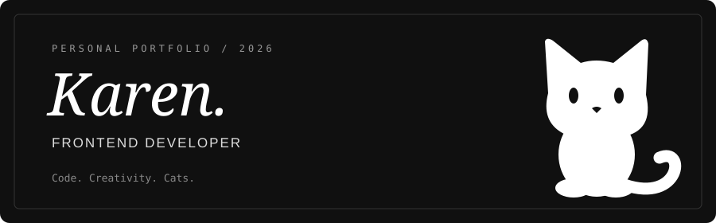

<div align="center">

# KAREN — PERSONAL PORTFOLIO

### Frontend Developer & Creative Web Designer

ฅ^•ﻌ•^ฅ

*Code, design and a little bit of magic.*


</div>

---

## About the project

A personal portfolio designed and developed to showcase
my professional experience, technical skills, creative
projects and personality.

## Features

- Responsive design
- Light and dark mode
- Spanish and English support
- Persistent user preferences
- Professional experience timeline
- Project showcase
- Freelance services
- Interactive feline companion

## Technologies

- Next.js
- React
- TypeScript
- Tailwind CSS
- Lucide React
- Next Themes
- Git & GitHub

## Getting started

Clone the repository:

```bash
git clone https://github.com/Hela426/karen-personal-portfolio.git
cd karen-personal-portfolio
npm install
npm run dev
```

Open http://localhost:3000 in your browser.

## Roadmap

- [x] Project initialization
- [x] Visual identity
- [x] Responsive layout
- [x] Dark and light mode
- [x] Internationalization
- [x] Interactive cat companion
- [ ] Custom illustration
- [ ] Interactive project gallery
- [ ] Downloadable resume
- [ ] Production deployment

## Developer

**Karen Baron**

Frontend Developer & Creative Web Designer  
Based in Colombia.

---

<div align="center">

Designed and developed with love.

**Supervised by Molly, the feline assistant.**

🐈‍⬛

© 2026 Karen Baron — Personal Portfolio

</div>